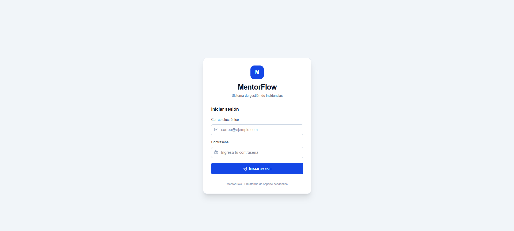
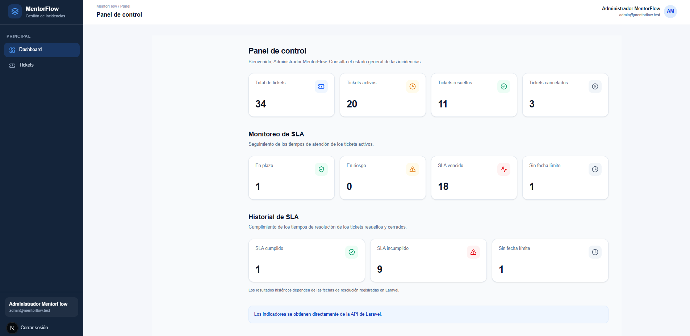
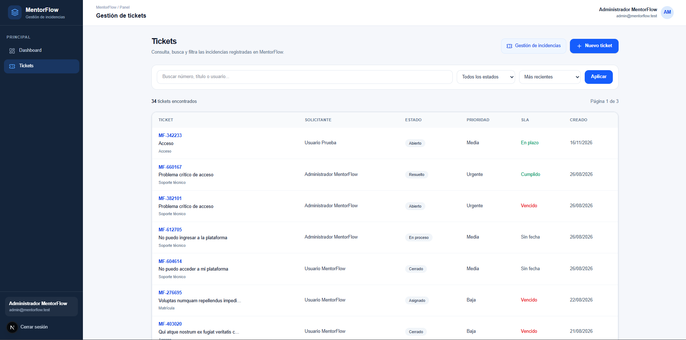
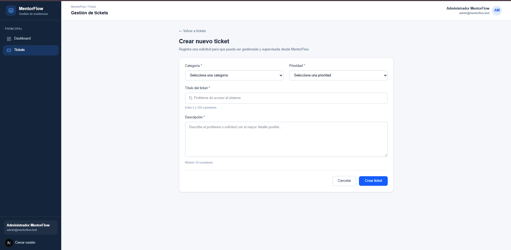
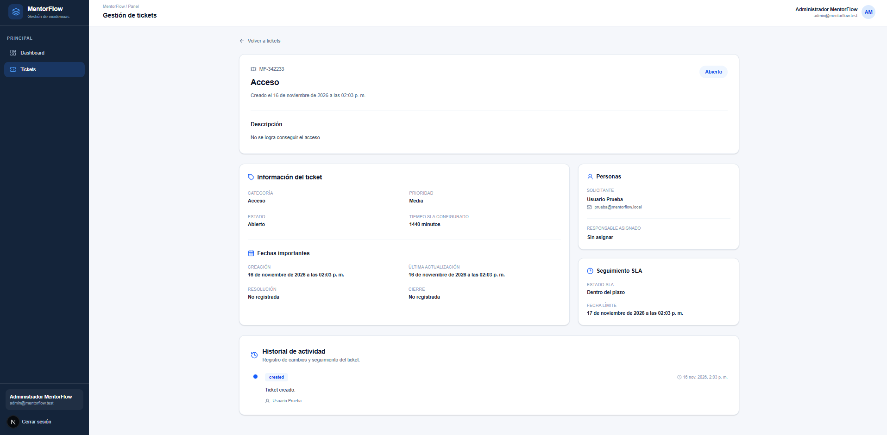

# MentorFlow

**Sistema web de gestión de incidencias y soporte académico.**

MentorFlow es una aplicación Full Stack desarrollada con Laravel, Next.js, TypeScript y MySQL. Permite centralizar solicitudes de soporte, administrar tickets, consultar su historial y supervisar los tiempos de atención mediante indicadores SLA.

El proyecto está orientado a instituciones educativas que necesitan organizar y dar seguimiento a incidencias académicas y técnicas.

## Tecnologías

### Backend
- PHP y Laravel 13
- API REST
- Laravel Sanctum
- MySQL
- Eloquent ORM
- Validación de solicitudes
- Roles, permisos y Policies

### Frontend
- Next.js 16
- React
- TypeScript
- Tailwind CSS
- Lucide Icons

### Herramientas
- Git y GitHub
- Composer
- Node.js y npm

## Funcionalidades implementadas

### Autenticación y seguridad
- Inicio de sesión.
- Autenticación mediante Laravel Sanctum.
- Protección de rutas y endpoints.
- Control de acceso mediante roles y permisos.
- Validación de datos desde el backend.

### Gestión de tickets
- Registro de nuevas incidencias.
- Generación automática de números de ticket.
- Clasificación por categorías y prioridades.
- Listado de tickets con búsqueda y filtros.
- Ordenamiento y paginación.
- Consulta del detalle de cada ticket.
- Historial de cambios.
- Cálculo automático del vencimiento según SLA.

### Dashboard
- Resumen de incidencias.
- Indicadores de gestión.
- Visualización del estado general de los tickets.

### Funcionalidades disponibles en la API
- Actualización de tickets.
- Cambio de estados.
- Eliminación de tickets.
- Consulta del historial.

Estas operaciones están implementadas en el backend. Su integración completa en la interfaz web continúa en desarrollo.

## Arquitectura

MentorFlow utiliza una arquitectura cliente-servidor:

- **Next.js:** interfaz web y comunicación segura con la API.
- **Laravel:** lógica de negocio, autenticación, autorización y endpoints REST.
- **MySQL:** almacenamiento de usuarios, tickets, categorías, prioridades e historial.

El frontend utiliza rutas de servidor para comunicarse con Laravel sin exponer el token de autenticación directamente al navegador.

## Estructura del proyecto

```text
mentorflow/
├── app/
│   ├── Http/
│   │   ├── Controllers/
│   │   ├── Requests/
│   │   └── Resources/
│   ├── Models/
│   ├── Policies/
│   └── Services/
├── database/
├── frontend/
│   ├── src/
│   │   ├── app/
│   │   ├── components/
│   │   ├── features/
│   │   ├── lib/
│   │   └── types/
│   └── package.json
├── routes/
│   └── api.php
└── README.md
```

## Instalación local

### Requisitos

- PHP compatible con Laravel 13
- Composer
- MySQL
- Node.js y npm

### 1. Clonar el repositorio

```bash
git clone https://github.com/cayaltaaldo/MentorFlow.git
cd MentorFlow
```

### 2. Configurar Laravel

```bash
composer install
cp .env.example .env
php artisan key:generate
```

Configurar la conexión MySQL en `.env`:

```dotenv
DB_CONNECTION=mysql
DB_HOST=127.0.0.1
DB_PORT=3306
DB_DATABASE=mentorflow
DB_USERNAME=tu_usuario
DB_PASSWORD=tu_contrasena
```

Crear la base de datos correspondiente y ejecutar:

```bash
php artisan migrate
```

Si el proyecto dispone de seeders preparados para el entorno local:

```bash
php artisan db:seed
```

Iniciar Laravel:

```bash
php artisan serve --host=127.0.0.1 --port=8000
```

### 3. Configurar Next.js

En otra terminal:

```bash
cd frontend
npm ci
```

Crear `frontend/.env.local`:

```dotenv
LARAVEL_API_URL=http://127.0.0.1:8000/api
```

Iniciar el frontend:

```bash
npm run dev
```

Abrir:

http://localhost:3000

## Endpoints principales

| Método | Endpoint | Descripción |
|--------|----------|-------------|
| POST | `/api/login` | Iniciar sesión |
| POST | `/api/logout` | Cerrar sesión |
| GET | `/api/user` | Consultar usuario |
| GET | `/api/tickets` | Listar tickets |
| POST | `/api/tickets` | Crear ticket |
| GET | `/api/tickets/{id}` | Consultar detalle |
| PUT | `/api/tickets/{id}` | Actualizar ticket |
| PATCH | `/api/tickets/{id}/status` | Cambiar estado |
| GET | `/api/tickets/{id}/history` | Consultar historial |
| GET | `/api/ticket-categories` | Listar categorías activas |
| GET | `/api/ticket-priorities` | Listar prioridades activas |
| GET | `/api/dashboard/tickets` | Consultar indicadores |

Los endpoints protegidos requieren autenticación y los permisos correspondientes.


## Capturas de pantalla

### Inicio de sesión
Autenticación de usuarios para acceder a las funcionalidades del sistema.



### Dashboard
Panel principal con indicadores y resumen de incidencias.



### Gestión de tickets
Listado de incidencias con opciones de búsqueda, filtros y paginación.



### Registro de incidencias
Formulario para crear tickets, seleccionar categorías y establecer prioridades.



### Detalle e historial
Consulta de la información del ticket y seguimiento de sus cambios.



## Estado del proyecto

MentorFlow es un proyecto de portafolio en desarrollo activo.

La versión actual incluye una interfaz funcional para autenticación, consulta, creación y seguimiento de tickets. Las próximas mejoras se centran en la edición, gestión de estados y experiencia de usuario.

## Autor

Desarrollado por Dayron Cayalta.

Estudiante de Diseño y Desarrollo de Software en TECSUP.

GitHub: https://github.com/cayaltaaldo
